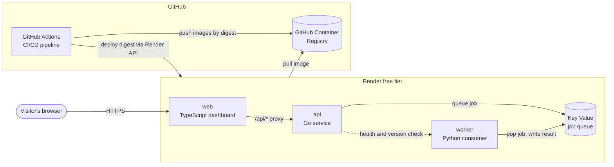
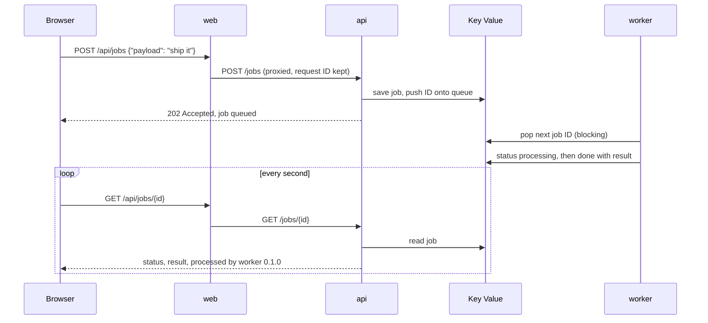
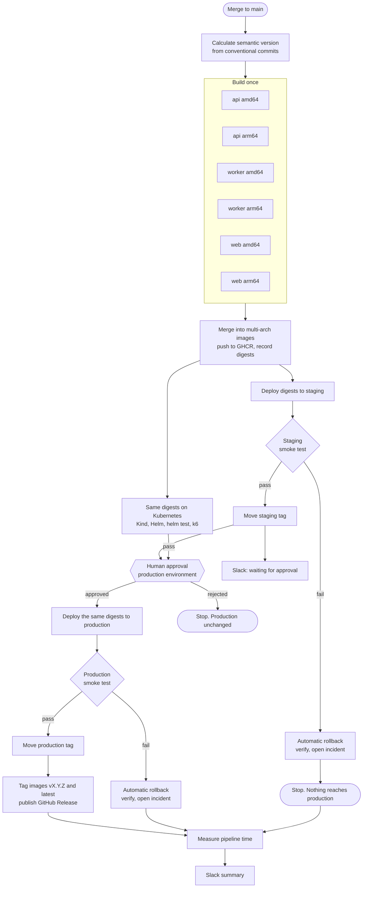
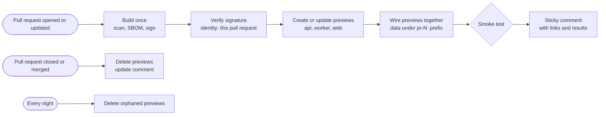

# Shipyard

**Build once. Containerize once. Deploy anywhere. No manual steps. Zero cost.**

[](https://github.com/devwithvino/cicd_demo/actions/workflows/ci.yml)
[](https://github.com/devwithvino/cicd_demo/actions/workflows/deliver.yml)
[](https://devwithvino.github.io/cicd_demo/)
[](https://github.com/devwithvino/cicd_demo/releases)
[](https://github.com/devwithvino/cicd_demo/actions/workflows/security.yml)
[](#supply-chain-security)
[](https://scorecard.dev/viewer/?uri=github.com/devwithvino/cicd_demo)
[](https://github.com/devwithvino?tab=packages&repo_name=cicd_demo)
[](docs/free-tier-limits.md)
[](LICENSE)

Shipyard is a reference delivery pipeline. A small microservices app travels from a `git push` to a live, verified production deployment, fully automated with GitHub Actions and hosted on free tiers. The app is deliberately simple. **The pipeline is the product.**

## Live demo

| What | Link |
|---|---|
| **Pipeline status and DORA metrics** | https://devwithvino.github.io/cicd_demo/ |
| Production app | https://shipyard-web-production.onrender.com |
| Staging app | https://shipyard-web-staging.onrender.com |
| Releases (versioned images and digests) | https://github.com/devwithvino/cicd_demo/releases |
| Pipeline runs | https://github.com/devwithvino/cicd_demo/actions |

> The demo runs on free instances that sleep after 15 minutes without traffic. The first visit can take about a minute while the services wake up. The dashboard says so and refreshes on its own.

## In 60 seconds

For a business reader, this is what the project shows:

- **Every change is checked automatically.** Code is linted, type checked and tested in three languages before it can ship.
- **Security is a gate, not an afterthought.** Every change is scanned for leaked secrets, code vulnerabilities and risky dependencies. Every container image is scanned, comes with a full parts list (SBOM), and is cryptographically signed. Production refuses anything the pipeline did not sign.
- **Software is built exactly once.** The same container image that passed testing is the one that runs in production. Nothing is rebuilt along the way, so what was tested is what customers get.
- **Releases are verified, not hoped for.** After every deploy, an automated smoke test sends a real job through the live system and confirms every service runs the expected version.
- **Every proposed change can be tried before it is accepted.** Each pull request gets its own temporary, fully working copy of the app with a link posted on the pull request. It disappears when the pull request closes.
- **People stay in control.** Staging updates automatically. Production needs one click of approval from a named reviewer.
- **Bad releases undo themselves.** If a release fails its checks after going live, the pipeline puts the previous version back on its own, confirms it works, and opens an incident report. In the recorded demo, service was restored in 28 seconds.
- **The team is told what happened.** Every delivery posts a plain language summary to Slack with the time it took, and a reviewer is pinged the moment production is waiting for approval.
- **Performance is measured, not claimed.** A public status page tracks the four industry standard DORA delivery metrics, calculated from every real pipeline run.
- **It looks after itself.** Dependencies update themselves weekly, safe updates merge on their own after every check passes, and nightly jobs re scan running software for newly published vulnerabilities and test production end to end.
- **It costs nothing to run.** Everything uses free tiers, and the hosting account has no payment method, so a bill is impossible.

### Measured on a real run

Numbers from [delivery run 38020394941](https://github.com/devwithvino/cicd_demo/actions/runs/38020394941), release [v0.1.0](https://github.com/devwithvino/cicd_demo/releases/tag/v0.1.0):

| Stage | Time |
|---|---|
| Build all three services for two CPU architectures, once | 1m 38s |
| Deploy to staging and smoke test | 45s |
| Human approval (not counted as pipeline time) | 1m 39s |
| Deploy the identical images to production and smoke test | 46s |
| Tag the release and publish it | 8s |
| **Commit to production, excluding the approval wait** | **about 3m 40s** |

And from the [deliberate failure demo](https://github.com/devwithvino/cicd_demo/actions/runs/38022224039), which shipped a broken release to staging on purpose:

| Event | Time (UTC) |
|---|---|
| Broken release starts deploying | 03:57:01 |
| Broken release live, health checks still green | 03:57:25 |
| Smoke test catches the defect | 03:57:27 |
| Previous release live again | 03:57:51 |
| Restored release verified | 03:57:55 |
| **Failure detected to service verified** | **28 seconds** |

The pipeline wrote all of this up automatically in [incident #1](https://github.com/devwithvino/cicd_demo/issues/1).

---

## The application

Shipyard is a small job processing system. A visitor types some text on the dashboard, the API queues it, a worker processes it, and the dashboard shows which version of each service handled the work.

| Service | Language | Role | Image |
|---|---|---|---|
| `web` | TypeScript on Node.js 24 | Dashboard and API proxy | `ghcr.io/devwithvino/shipyard-web` |
| `api` | Go 1.26 | Accepts jobs, reports status, aggregates health | `ghcr.io/devwithvino/shipyard-api` (22 MB, distroless) |
| `worker` | Python 3.13 | Processes jobs from the queue | `ghcr.io/devwithvino/shipyard-worker` |
| Key Value | Valkey (Redis compatible) | Job queue and job records | Render managed |

Three languages are used on purpose. They prove the pipeline handles any stack with the same build, scan and deploy steps.

### Architecture



Each environment (staging and production) runs its own copy of `web`, `api` and `worker`. Both environments share one free Key Value instance, and every key carries an environment prefix (`stg:` or `prd:`), so their data never mixes.

### How a job flows



### What the dashboard shows

- A card per service with its **version, commit (linked to GitHub), environment, health and uptime**, plus the exact image digest when deployed by the pipeline.
- A **"one build everywhere"** badge that turns green only when every service reports the same commit.
- A colored banner per environment: green for production, amber for staging, purple for previews, grey for local.
- A **Run a job** panel with live progress (queued, picked up, done) and a table of recent jobs showing which version submitted and processed each one.
- Release links to pipeline runs, releases and security results.

### API endpoints

| Service | Endpoint | Purpose |
|---|---|---|
| all | `GET /healthz` | Liveness. Used by Render's health check |
| all | `GET /version` | Version, commit, build time, environment, uptime, image digest |
| all | `GET /metrics` | Prometheus metrics |
| api, worker | `GET /readyz` | Readiness. Fails when Key Value is unreachable |
| api | `POST /jobs` | Queue a job, body `{"payload": "text"}` |
| api | `GET /jobs`, `GET /jobs/{id}` | Recent jobs, or one job |
| api | `GET /status` | Health of api, Key Value and worker in one call |
| web | `/api/*` | Proxy to the API, so the browser only talks to one origin |

### Built for production habits

- Structured JSON logs with request IDs passed from web to api.
- Graceful shutdown on `SIGTERM`, so deploys drain in-flight requests.
- Separate liveness and readiness probes.
- Containers run as non-root users. The Go image is distroless, with no shell or package manager.
- Strict security headers on the dashboard (Content Security Policy, no framing, no sniffing). The browser code builds the page without `innerHTML`, so API data can't inject markup.
- Runtime settings come from environment variables. Version, commit and build time are baked into the image at build time. That combination is what makes one image deployable anywhere.

---

## The CI/CD pipeline

### Delivery flow



Pull requests run the CI checks below. Merges to `main` run the full delivery flow.

### Build once, promote by digest

A container image is identified by a **digest**, a fingerprint of its exact contents. Shipyard builds each service once per change and then refers to it only by digest. Staging and production receive the identical digest, so the production artifact is byte for byte the one that passed staging.

- **Native multi-arch builds.** Each service is built on a native amd64 runner and a native arm64 runner in parallel, with no slow CPU emulation. The two results are merged into one multi-arch image. Render pulls the amd64 variant, and the same image runs on Apple Silicon laptops and arm64 Kubernetes nodes.
- **Layer caching.** Each service and architecture has its own GitHub Actions cache scope, so unchanged layers are reused.
- **Multi-stage Dockerfiles.** Compilers and dev dependencies stay in the build stage. Runtime images contain only what the service needs.
- **Semantic versions.** [`scripts/next_version.py`](scripts/next_version.py) reads conventional commit messages since the last release tag: `feat` bumps the minor version, `fix` bumps patch, a `!` bumps major.

Tags tell the story of each digest. None of them trigger a rebuild:

| Tag | Meaning | Moves? |
|---|---|---|
| `sha-82bd16f` | Built from this commit | Never |
| `0.1.0-rc.5` | Release candidate from delivery run 5 | Never |
| `main` | Latest build from the main branch | On every build |
| `staging` | Currently verified in staging | Only after a staging smoke test passes |
| `production` | Currently verified in production | Only after a production smoke test passes |
| `0.1.0`, `latest` | Released to production | Added at release |

### Deploying to Render

Render never builds anything. Every service is image backed, and the pipeline tells Render exactly which digest to run through the Render API. [`scripts/render_deploy.py`](scripts/render_deploy.py):

1. Records the image each service runs now. This record is what rollback will use.
2. Sets an `IMAGE_REF` variable so the app can display its own digest.
3. Deploys the new digest to all three services in parallel.
4. Polls each deploy until it is live, fails or times out.

Render then health checks each new instance and only switches traffic once it is healthy. That gives zero downtime deploys even on the free tier.

### Smoke tests

[`scripts/smoke_test.py`](scripts/smoke_test.py) runs after every deploy and writes its report into the run summary:

1. **Warm up.** Waits up to four minutes for every service to answer `/healthz`, because free instances may be asleep.
2. **Version.** Every service must report the commit being deployed. This proves the intended build is the one actually serving traffic.
3. **Wiring.** The web service must reach the API, and the API must reach the worker.
4. **End to end.** A real job is submitted through the public web URL and must be completed by the worker.

The test deliberately goes beyond health checks. A release can be "healthy" and still broken, and the rollback demo relies on exactly that.

### Automatic rollback

Every deploy records which image each service was running before it started. If the deploy or its smoke test fails, [`_deploy-render.yml`](.github/workflows/_deploy-render.yml) immediately:

1. Redeploys the recorded previous images to all services in parallel.
2. Runs the full smoke test again against the restored release.
3. Measures the time from detecting the failure to a verified restore.
4. Opens an [incident issue](https://github.com/devwithvino/cicd_demo/issues?q=label%3Aincident) with a summary, the failed checks and a timeline.
5. Marks the deployment as failed, keeps the environment tag on the last good release, and stops the release from going any further.

There are two layers of protection, and each covers a different kind of failure:

| Layer | Catches | Example |
|---|---|---|
| Render health check | A release that will not start or answer | Crash on boot. Render never switches traffic, the old instance keeps serving |
| Pipeline smoke test and rollback | A release that runs but does the wrong thing | Job submission broken while health checks stay green |

### The deliberate failure demo

[`demo-failure.yml`](.github/workflows/demo-failure.yml) shows the second layer working, on demand. It builds today's code with a deliberate defect (`BROKEN_RELEASE=true`) that breaks job submission but keeps every health check green, so Render is happy to run it. Then it deploys that release to staging, or to production after approval. The smoke test fails at "job accepted", the pipeline rolls back, verifies, opens an incident and posts a red then green summary to Slack.

To run it: **Actions, demo-failure, Run workflow**, choose an environment. The run itself ends red, because the broken release really did fail. The "Verify automatic recovery" job is the one that must be green.

### Manual deploy and one click rollback

Releases stay deployable after they ship. [`deploy-manual.yml`](.github/workflows/deploy-manual.yml) and [`rollback.yml`](.github/workflows/rollback.yml) resolve a version through [`_resolve-release.yml`](.github/workflows/_resolve-release.yml) to the exact digests released for it, then use the same deploy, smoke test and automatic rollback as the main pipeline.

- `rollback` defaults to **previous**: the newest release older than what the environment runs now. It asks for a reason, which goes into the team notification.
- `deploy-manual` takes any released version and has a **dry run** option that only prints the plan.
- Production still requires approval for both.
- An unknown version is refused, with the list of available releases.

### Supply chain security

Every image goes through three gates inside the build, before any moving tag points at it:

| Gate | Tool | Blocks the release when |
|---|---|---|
| Vulnerability scan | Trivy | A HIGH or CRITICAL vulnerability with an available fix is found |
| Software bill of materials | Syft (SPDX) | Always produced, attached to the GitHub Release and attested |
| Signature and provenance | cosign keyless, GitHub attestations | Signing or attestation fails |

Signing is **keyless**: the identity is the build workflow itself, proven by GitHub's OIDC token and recorded in the public Sigstore transparency log. No signing key exists, so none can leak. Each image also carries a **SLSA build provenance** attestation (which repository, workflow, commit and runner built it) and an **SBOM attestation**.

Before any deploy, [`_deploy-render.yml`](.github/workflows/_deploy-render.yml) verifies every digest. The signature identity must be exactly `.github/workflows/_build.yml@refs/heads/main` in this repository, and the provenance must verify. An image built anywhere else, or before signing existed, is **refused** and nothing is deployed. This was tested by asking the pipeline to deploy v0.3.0, which predates signing: [all three images were refused](https://github.com/devwithvino/cicd_demo/actions/runs/38026973572) and staging stayed on 0.4.0.

Anyone can check an image independently:

```bash
gh attestation verify oci://ghcr.io/devwithvino/shipyard-api@<digest> --repo devwithvino/cicd_demo
```

Hardening the gates surfaced real findings, which were fixed rather than ignored:

- The Node and Python base images bundled npm and pip with known HIGH vulnerabilities. Both package managers are now removed from the runtime images, since nothing uses them at runtime.
- CodeQL found a log injection path: a caller supplied `X-Request-ID` header was logged unchanged. Both api and web now accept only short, plain request IDs.

### Code and repository scanning

[`security.yml`](.github/workflows/security.yml) runs on every pull request, every push to `main` and every night, and reports to the repository's Security tab:

| Check | Tool | Scope |
|---|---|---|
| Secret scanning | gitleaks | Full git history |
| Code scanning | CodeQL (security extended) | Go, Python, TypeScript and the workflow files |
| Dependency review | GitHub dependency review | New dependencies in a pull request, HIGH severity or worse, plus banned licenses |
| Configuration scanning | Trivy | Dockerfiles and infrastructure as code |

[`ci.yml`](.github/workflows/ci.yml) adds hadolint for Dockerfiles, actionlint for workflow correctness and zizmor for workflow security. [`pr-title.yml`](.github/workflows/pr-title.yml) requires Conventional Commit titles, because titles drive semantic versioning.

GitHub's own secret scanning with **push protection**, the dependency graph and Dependabot alerts are also enabled, so known credential formats are stopped before a commit even lands.

### Branch protection

`main` only changes through pull requests. A ruleset requires three checks to pass before a squash merge: **CI passed**, **Security passed** and **conventional commit title**. Force pushes and branch deletion are blocked, and there are no bypass actors.

[Pull request #2](https://github.com/devwithvino/cicd_demo/pull/2) proves it. It deliberately added a hard coded API token, lodash 4.17.20 and a non conventional title. Gitleaks caught the token, dependency review caught two HIGH lodash advisories, and the title check failed. GitHub marked it blocked, and it was closed without merging.

### A real incident, handled by the pipeline

During the build of this project a GitHub App private key file was saved in the working folder and committed by mistake. The new gitleaks gate flagged it on the first scan, about two minutes after the push. The key was deleted and replaced, the file removed, key patterns added to `.gitignore`, and the finding recorded with its resolution in [`.gitleaksignore`](.gitleaksignore). This is exactly the failure the gate exists for, and it is why scanning runs on every push and nightly over the full history.

### Pull request preview environments

Every pull request from this repository gets its own running copy of the whole app, posted as a link on the pull request ([example on #5](https://github.com/devwithvino/cicd_demo/pull/5)).



Render's multi service Preview Environments need a paid plan, so [`scripts/render_preview.py`](scripts/render_preview.py) assembles the same thing from free single service previews:

1. Creates a preview of each staging service named `shipyard-<service>-pr-<number>`, or reuses it on later pushes.
2. Copies the staging configuration, then overrides it: `APP_ENV=pr-N`, a `pr-N:` Key Value prefix so preview data never mixes with staging or production, and the api and web pointed at the preview worker and preview api.
3. Deploys the pull request's signed digests and waits until all three are live.

[`pr-preview.yml`](.github/workflows/pr-preview.yml) then smoke tests the preview with the same script used for staging and production, and keeps one comment on the pull request up to date. Before deploying, it verifies the images were signed by this repository's build running for that exact pull request. When the pull request closes, the previews are deleted and the comment says so. Render does not delete image previews on its own, so [`preview-janitor.yml`](.github/workflows/preview-janitor.yml) removes any preview whose pull request is no longer open, every night.

Pull requests from forks get the full CI and security checks but no preview, because they never receive secrets.

### Deploy anywhere: the same images on Kubernetes

Render is one target, not a dependency. Every delivery also installs the **exact same signed digests** on a fresh Kubernetes cluster ([Kind](https://kind.sigs.k8s.io/)) inside GitHub Actions, in parallel with staging. Production needs both to pass. Every pull request runs it too.

[`_kind-e2e.yml`](.github/workflows/_kind-e2e.yml):

1. Verifies the signatures of the digests it was handed.
2. Creates a Kind cluster and installs the [Helm chart](deploy/helm/shipyard) pinned to those digests.
3. Runs `helm test`, which checks health, wiring and a full job round trip from inside the cluster.
4. Runs the same smoke test used on Render, through port forwards.
5. Runs a [k6](https://k6.io) performance gate: 10 virtual users for 30 seconds, failing on more than 1% errors, read p95 over 300 ms or write p95 over 500 ms.
6. Dumps pod state and logs if anything fails.

The chart is written for real clusters, not just the demo:

| Concern | How the chart handles it |
|---|---|
| Image provenance | Images pinned by digest |
| Least privilege | Non root users, read only root filesystem, all Linux capabilities dropped, seccomp `RuntimeDefault`, no service account token |
| Network | Default deny network policies. Only web is reachable from anywhere. api accepts web, worker accepts api, Key Value accepts api and worker |
| Health | Liveness and readiness probes per service, readiness tied to Key Value |
| Capacity | Requests and limits for every container, two replicas for api and web |
| Data | In cluster Valkey by default, or any managed Redis compatible URL |

```bash
helm install shipyard deploy/helm/shipyard \
  --set images.api.digest=sha256:... \
  --set images.worker.digest=sha256:... \
  --set images.web.digest=sha256:...
```

CI lints the chart and validates the rendered manifests against Kubernetes 1.33 schemas with kubeconform.

### Housekeeping that runs itself

| Automation | What it does |
|---|---|
| [Dependabot](.github/dependabot.yml) | Weekly updates for Go, Python, npm, Dockerfile base images, compose images and workflow actions. Minor and patch updates are grouped per ecosystem. A seven day cooldown skips brand new releases, a cheap defence against hijacked packages |
| [Auto merge](.github/workflows/dependabot-automerge.yml) | Patch and minor Dependabot updates merge on their own once every required check passes. Major updates always wait for a human |
| [Nightly](.github/workflows/nightly.yml) | Re scans the images running in staging and production for newly published CVEs, runs one synthetic production smoke test, and checks every documentation link. Failures open issues and alert Slack |
| [OpenSSF Scorecard](.github/workflows/scorecard.yml) | An independent audit of supply chain practices, published as the badge above |
| [Preview janitor](.github/workflows/preview-janitor.yml) | Deletes preview environments whose pull request is gone |

The policy is enforced by humans too. Dependabot's first run proposed three major upgrades: Node 25 (not an LTS release), Node type definitions 26 (would not match the Node 24 runtime) and Valkey 9 (would break parity with Render's managed Valkey 8). All three were declined with a reason, and the reasoning now lives as ignore rules in the Dependabot config.

Scorecard started at 5.6. Real fixes followed rather than cosmetic ones: a [security policy](SECURITY.md) with private vulnerability reporting, Go fuzz tests for the code that handles untrusted input, base images pinned by digest, and releases that carry their Sigstore provenance bundles. A few checks can not improve for a young single maintainer project, such as reviews by a second person and project age.

### Protecting production from infrastructure syncs

Render redeploys a service whenever its Blueprint (`render.yaml`) changes. If the Blueprint pointed at `main`, an infrastructure edit could push an unapproved build into production. Instead, each environment has its own moving tag that only advances after that environment's smoke test passes. A Blueprint sync can therefore only redeploy an image that already passed in that environment.

### Status page and DORA metrics

The [status page](https://devwithvino.github.io/cicd_demo/) is the one page to show a client. It has three parts:

- **Live environments.** The page asks every service in staging and production for its health and version, straight from the browser, and shows whether each environment runs one build everywhere.
- **DORA metrics.** The four key measures of delivery performance from the DORA research program, each with its elite, high, medium or low rating.
- **History.** Every deployment with its result (success, rolled back, not approved), deploy time and links to the run and any incident, plus releases and incidents.

| DORA metric | How Shipyard measures it |
|---|---|
| Deployment frequency | Successful production deploys per week |
| Lead time for changes | Median time from commit to live in production. Also shown without the approval wait |
| Change failure rate | Share of production deploys that failed or were rolled back. Deliberate drills are excluded |
| Time to restore | Median time from failure detected to service verified, read from incident issues |

[`scripts/dora_metrics.py`](scripts/dora_metrics.py) computes all of it from GitHub Actions runs and jobs, the `deploy-record.json` every deploy uploads, incident issues and releases. [`status-page.yml`](.github/workflows/status-page.yml) regenerates the page after every deploy related run and every 6 hours, and publishes it to GitHub Pages using OIDC, so no deploy token is stored.

### Workflows

| Workflow | Trigger | What it does |
|---|---|---|
| [`ci.yml`](.github/workflows/ci.yml) | Pull requests, pushes to `main` | Detects which services changed and checks only those. Go: golangci-lint and tests with the race detector. Python: ruff, mypy in strict mode, pytest with coverage. TypeScript: eslint, tsc, vitest with coverage, production build. Plus prose lint. One aggregate "CI passed" check for branch protection |
| [`deliver.yml`](.github/workflows/deliver.yml) | Pushes to `main` (code changes), manual run | The delivery flow above |
| [`_build.yml`](.github/workflows/_build.yml) | Called by other workflows | Reusable build once: native multi-arch matrix, push by digest, merge, Trivy gate, SBOM, keyless signing, provenance and SBOM attestations, then tags |
| [`_deploy-render.yml`](.github/workflows/_deploy-render.yml) | Called by other workflows | Reusable deploy to one environment: verify signature and provenance, deploy by digest, smoke test, automatic rollback with incident issue on failure, move the environment tag on success, keep the deploy record for 90 days |
| [`demo-failure.yml`](.github/workflows/demo-failure.yml) | Manual run | Ships a deliberately broken release and verifies the automatic recovery |
| [`rollback.yml`](.github/workflows/rollback.yml) | Manual run | One click rollback to the previous release, or a chosen one |
| [`deploy-manual.yml`](.github/workflows/deploy-manual.yml) | Manual run | Deploy any released version to any environment, with a dry run option |
| [`status-page.yml`](.github/workflows/status-page.yml) | After deploy related runs, every 6 hours, manual run | Recomputes DORA metrics and publishes the status page to GitHub Pages |
| [`security.yml`](.github/workflows/security.yml) | Pull requests, pushes to `main`, nightly | gitleaks, CodeQL, dependency review and Trivy config scan, reported to the Security tab |
| [`pr-title.yml`](.github/workflows/pr-title.yml) | Pull requests | Conventional Commit title check |
| [`pr-preview.yml`](.github/workflows/pr-preview.yml) | Pull requests (opened, updated, closed) | Builds, verifies, deploys and smoke tests a preview environment, comments the links, deletes it on close |
| [`preview-janitor.yml`](.github/workflows/preview-janitor.yml) | Nightly, manual run | Deletes previews whose pull request is no longer open |
| [`nightly.yml`](.github/workflows/nightly.yml) | Nightly, manual run | Re scan running images, synthetic production check, link check |
| [`scorecard.yml`](.github/workflows/scorecard.yml) | Pushes to `main`, weekly | OpenSSF Scorecard |
| [`dependabot-automerge.yml`](.github/workflows/dependabot-automerge.yml) | Dependabot pull requests | Queues patch and minor updates for auto merge |
| [`_notify.yml`](.github/workflows/_notify.yml) | Called by other workflows | Reusable Slack notification: colored status, summary, version, commit, timings and link buttons, including approval requests |
| [`_kind-e2e.yml`](.github/workflows/_kind-e2e.yml) | Called by deliver and pr-preview | Same digests on a Kind cluster: verify, helm install, helm test, smoke test, k6 performance gate |
| [`_resolve-release.yml`](.github/workflows/_resolve-release.yml) | Called by other workflows | Turns a version, or "previous", into the released digests and commit |

Pipeline practices applied throughout:

- **Least privilege.** Every workflow starts with `permissions: {}` and each job asks only for what it needs.
- **Pinned actions.** Third party actions are pinned to full commit SHAs, not movable tags.
- **One secret, by name.** Reusable workflows never inherit all secrets. The deploy receives exactly one secret name, and its value comes from the deploy job's GitHub environment.
- **Concurrency control.** CI cancels outdated runs on the same pull request. Deliveries run one at a time. Each environment has its own deploy lock shared by every workflow, so a demo, a rollback and a delivery can never deploy to the same environment at once. Deploys are never cancelled midway.
- **Readable summaries.** Every stage writes a Markdown summary to the run page, so anyone can see what was built, where it went and what was checked.

### Environments and secrets

| GitHub environment | Protection | Holds |
|---|---|---|
| `staging` | Automatic | Render API key (secret), service IDs and URLs (variables) |
| `production` | Required reviewer, `main` branch only | Its own Render API key, released to a job only after approval |
| `preview` | Automatic | Render API key (secret) and the staging service IDs that previews are created from (variables) |

- Images are pushed with the short lived `GITHUB_TOKEN`. There is no personal access token anywhere.
- The status page is published through OIDC (`id-token: write`), with no stored deploy token.
- Release tagging can use a short lived GitHub App token (`RELEASE_APP_CLIENT_ID` variable and `RELEASE_APP_PRIVATE_KEY` secret). The built in token can not tag a commit whose workflow files differ from `main`, which happens when `main` moves on while a release waits for approval. Without the App, the built in token is used.
- Images are public, so Render needs no registry credential.
- Images are signed and attested through OIDC. There is no signing key to store or rotate.
- Render does not support OIDC federation, so its API key is stored as an environment secret, scoped per environment.
- The Slack webhook is a repository secret. Notifications skip quietly when it is absent, so forks never fail.

---

## Zero cost, by design

| Piece | Free because |
|---|---|
| GitHub Actions, including arm64 runners | Free and unlimited for public repositories |
| GitHub Container Registry | Free for public images |
| GitHub Pages status page | Free for public repositories |
| Render web services and Key Value | Free instance types |
| Render build minutes | Not used. Images are built in GitHub Actions |
| Slack notifications | Free incoming webhooks |

Free tiers come with limits: instances sleep after 15 minutes idle, 750 instance hours a month are shared by all services, one free Key Value instance, 5 GB of bandwidth a month, and no free background worker type (so the worker runs as a free web service). Each limit and how the design handles it is documented in [docs/free-tier-limits.md](docs/free-tier-limits.md), together with the results of the platform spike that proved the approach before any code was written.

---

## Run it locally

Requirements: Docker with Compose.

```bash
docker compose up --build
```

Open http://localhost:8080. The stack includes `web`, `api`, `worker` and a Valkey container that mirrors Render Key Value. To bake real build metadata into the local images:

```bash
GIT_SHA=$(git rev-parse HEAD) VERSION=0.1.0-local docker compose up --build
```

To run the released images from GHCR instead of building:

```bash
SHIPYARD_TAG=0.1.0 docker compose up
```

Add Prometheus and a ready made Grafana dashboard (services up, request rate, error rate, p95 latency, jobs processed, job duration):

```bash
docker compose --profile observability up --build
```

Grafana opens at http://localhost:3000 with the dashboard as its home page. Prometheus is at http://localhost:9090.

Run the k6 performance test against the local stack:

```bash
docker run --rm -v "$PWD/tests/load:/scripts" grafana/k6:2.3.0 run -e BASE_URL=http://host.docker.internal:8080 /scripts/smoke.js
```

Smoke test the local stack with the same script the pipeline uses:

```bash
python scripts/smoke_test.py --web http://localhost:8080 --api http://localhost:8090 --worker http://localhost:8091
```

### Run the tests

| Service | Command (from the service folder) |
|---|---|
| api | `go test -race ./...` |
| worker | `uv sync && uv run pytest` |
| web | `npm ci && npm test` |
| scripts | `python scripts/prose_lint.py .` |

---

## Repository layout

```text
.
├── services/
│   ├── api/          Go API: cmd/, internal/, tests, Dockerfile
│   ├── worker/       Python worker: src/, tests/, uv.lock, Dockerfile
│   └── web/          TypeScript dashboard: src/server, src/client, public/, Dockerfile
├── deploy/
│   ├── helm/shipyard/     Hardened Helm chart with network policies and helm test
│   └── observability/     Prometheus config and the Grafana dashboard
├── tests/load/            k6 performance gate
├── scripts/
│   ├── next_version.py    Semantic version from conventional commits
│   ├── render_deploy.py   Deploy, record and roll back image digests on Render
│   ├── render_preview.py  Wired pull request previews on Render, teardown and janitor
│   ├── smoke_test.py      Post deploy verification used everywhere
│   ├── dora_metrics.py    DORA metrics and deployment history from real runs
│   └── prose_lint.py      House writing style check
├── .github/workflows/     ci, deliver, demo-failure, rollback, deploy-manual and the reusable _ workflows
├── status-site/           Static status page published to GitHub Pages
├── docs/
│   └── free-tier-limits.md
├── render.yaml            Render Blueprint: 6 free web services and 1 Key Value
└── docker-compose.yml     Local stack using the same images
```

---

## Roadmap

| Phase | Scope | Status |
|---|---|---|
| 0 | Platform spike: deploy by digest, previews, free tier limits | Done |
| 1 | Application services, tests, Dockerfiles, local stack | Done |
| 2 | CI, build once, staging, approval, production, release, team notifications | Done |
| 3 | Automatic rollback, deliberate failure demo, manual deploy and rollback workflows, incident issues | Done |
| 4 | Status page with live health and DORA metrics on GitHub Pages | Done |
| 5 | Security gates: secret scanning, CodeQL, dependency review, image scanning, SBOM, signing and provenance, branch protection | Done |
| 6 | Pull request preview environments on Render | Done |
| 7 | Same images on Kubernetes (Kind in Actions, Helm), performance smoke test, local Grafana | Done |
| 8 | Dependabot with safe auto merge, nightly checks, OpenSSF Scorecard hardening | Done |
| 9 | Case study, runbook, demo script and services overview | Next |

## License

MIT, see [LICENSE](LICENSE).
